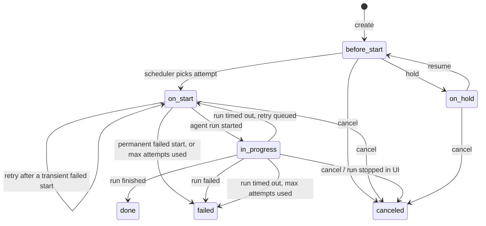
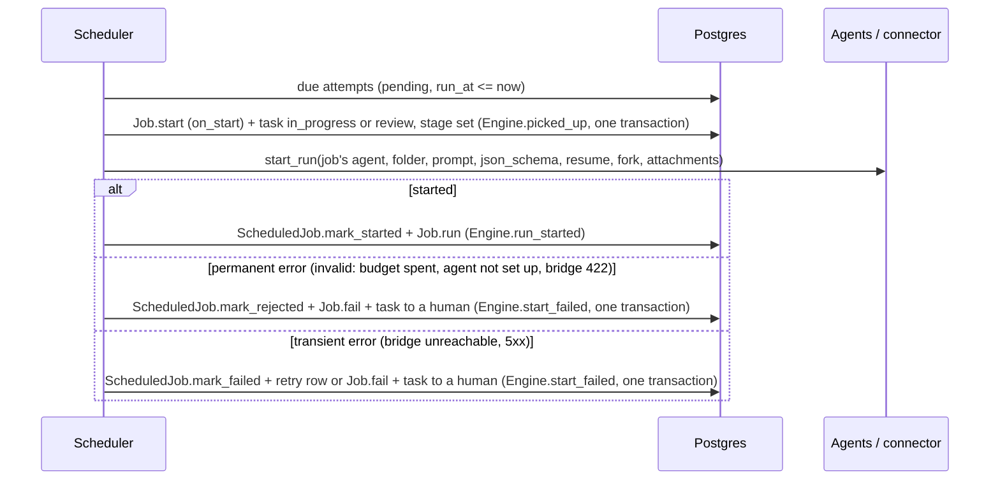

# Job scheduler

The scheduler hands board tasks to the agents their workflow blocks pick (docs/workflows.md). When a task needs
doing you create a **Job**. The scheduler starts an agent run for it, watches the run, and
marks the job done when the run finishes (or failed when the run fails). It retries a failed start, and
once a job is done it starts the jobs chained after it.

Code: `lib/weworkai/scheduling/` (Ash domain `Weworkai.Scheduling`).

Board tasks normally get their jobs from their workflow graph (docs/workflows.md;
`Weworkai.Workflows.Engine`, which the scheduler reports every run's start, result and
failure to). By hand:

```elixir
Scheduling.create_job!(%{task_id: task.id, agent_id: agent.id, folder: "~/Projects/app", prompt: "Fix it"})
Scheduling.create_job!(%{task_id: other.id, agent_id: agent.id, folder: "~/Projects/app", prompt: "Then this", previous_job_id: job.id})
Scheduling.hold_job!(job)    # only before it starts
Scheduling.resume_job!(job)
Scheduling.cancel_job!(job)  # stops the agent run if one is running
```

## Design: Temporal, cut down to one node

The design follows [Temporal](https://github.com/temporalio/temporal)'s History Service
([architecture doc](https://github.com/temporalio/temporal/blob/main/docs/architecture/history-service.md)),
scaled down to a single GenServer and a single Postgres-backed queue.

| Temporal | Here |
|---|---|
| Activity: a unit of work with mutable state | `Job` |
| Activity task + a timer/transfer task row in the history shard | `ScheduledJob`: one row per attempt, due at `run_at` |
| Timer queue processor, which fires tasks whose time has come | `Scheduler` tick, which reads due `ScheduledJob`s every second |
| Matching service, which hands tasks to polling workers | `Agents.start_run`, which starts a session on the agent's connector |
| Activity retry timer (attempt + 1, backoff) | a new `ScheduledJob` row with `attempt + 1` and a later `run_at` |
| Transactional outbox: state change and its tasks persisted in one transaction | `after_action` hooks in the Job / ScheduledJob actions |
| At-least-once task delivery | the same (see [Crashes](#crashes)) |

What we left out of Temporal: event history (the rows are the state), workflows as code,
task queue partitions, schedule-to-close timeouts, and multiple shards. Its heartbeat and
start-to-close timeouts have a cut-down stand-in: the bridge reports when each run last
wrote anything, and a run silent or running too long is stopped and retried ([Timeouts](#timeouts)).

## Data model

**`jobs`** (`Weworkai.Scheduling.Job`)

| field | |
|---|---|
| `id` | uuid |
| `task_id` | the board task |
| `agent_id` | the agent that runs it (not necessarily the task's assignee: reviewers run on the coder's task) |
| `previous_job_id` | optional. The job waits until this one is `done`. Next jobs are derived through `has_many :next_jobs`, so there is one source of truth and fan-out works |
| `stage` | what the run's result is for (`Job.Stage`): a workflow stage (docs/workflow.md), or `ask`, a human's question answered beside the workflow; nil runs the task as written |
| `folder` | working directory for the agent run |
| `prompt` | what the agent is told (≤ 400 000 chars, the bridge's limit) |
| `json_schema` | optional. The run ends with structured output matching it |
| `resume` | optional. Claude conversation the run continues |
| `fork` | default false; needs `resume`. The run continues a copy of that conversation, leaving it untouched (questions use it) |
| `stall_timeout_minutes` | default 15 (above Claude Code's 10-minute Bash tool limit, so a long command isn't a stall). A run that writes nothing this long is stopped and retried |
| `turn_timeout_minutes` | default 120. A run that has run this long is stopped and retried |
| `status` | see the lifecycle below |

**`scheduled_jobs`** (`Weworkai.Scheduling.ScheduledJob`)

| field | |
|---|---|
| `id` | uuid |
| `job_id` | the job this is an attempt of |
| `attempt` | 1, 2, 3… within one run of retries |
| `run_at` | not dispatched before this time |
| `state` | `pending`, `started`, `completed`, `failed` or `canceled` |
| `agent_run_id` | the agent run this attempt started |
| `error` | why the start failed |

## Lifecycles



- `before_start`: waiting for the previous job, or for the attempt's `run_at`.
- `on_start`: the scheduler picked the job up, and an agent run is being started or a retry is waiting.
- `in_progress`: the agent's run is working.
- `done`: the run finished. The next jobs get their first attempt.
- `on_hold`: paused by hand, and the queued attempt is canceled. A running agent cannot be paused, so this is only possible before the job starts.
- `canceled`: canceled by hand, or the run was stopped (dashboard or bridge).
- `failed`: the start failed permanently, every start attempt failed, or the run itself failed. A failed run is not retried (it may have changed files already) and its next jobs stay waiting.

Each action declares which statuses it may move from (`attribute_in`). An illegal move,
such as holding a job that is `in_progress`, returns an error instead of corrupting state.

```mermaid
stateDiagram-v2
  [*] --> pending
  pending --> started: run started
  pending --> failed: start failed (transient: queues next attempt or fails job; permanent: fails job)
  started --> completed: run done (completes job)
  started --> failed: run failed (fails job)
  started --> failed: run timed out (queues next attempt, or fails job)
  pending --> canceled
  started --> canceled
```



## Flows

**Queueing.** `Job.create` and `Job.resume` insert attempt 1 in the same transaction,
unless the previous job isn't done. `Job.complete` queues the waiting next jobs in its own
transaction. So a job is never left `before_start` with nothing that will pick it up,
except when its previous job ends `canceled` or `failed`. Such a job waits until you
cancel it.

**Dispatch** (`Scheduler.dispatch_due/0`, every 1s):



**Completion** (`Scheduler.sync_runs/1`): the scheduler watches runs through
`SessionPoller.watch_runs/0` and gets `{:runs, runs, statuses}` every 2s. No second
poller hits the bridge. For each `started` attempt:

- `:done`: `Engine.run_done` fetches the run's result, and in one transaction the attempt is `completed`, the job is `done`, the next jobs are queued and the result is applied to the task (docs/workflow.md). If the bridge can't be reached the attempt stays `started` until the next sync. A result without the structured output its stage needs counts as `:failed`.
- `:failed` (the run errored or exited non-zero), or `:ended` (the bridge no longer knows the run, or its agent's connector was removed, so nothing can ask about it): `Engine.run_failed` marks the attempt `failed` with the reason in `error` and the job `failed`, and hands the task to a human, in one transaction.
- A consumed run (done or failed) is then closed (`stopped_at`), so it leaves the dashboard.
- **Cost ledger.** In the same transaction, a consumed run's usage (input, output and cache tokens, USD, run time, turns, as the bridge reads them from Claude Code's final `result` event) is written to `run_usages` (`Agents.RunUsage`), one row per run (an upsert, so a result seen twice counts once), with the run's agent and task. A failed run's usage is read on a best-effort basis; a run the bridge no longer knows leaves no row. Each run reports its own turns only, so a resumed conversation is never counted twice. Totals (`Agents.Usage`) show on the task header, its Runs tab, the run page, the audit timeline (per bar and in the tiles) and, per agent for the last 7 days, on the audit page.
- **Budgets** (`Agents.Budget`). A task may have a USD cap over all its runs (`budget_usd`, set in the task page's header) and an agent one per day or week, UTC (`budget_usd`, `budget_period`, set where the agent is configured on the Employees page). A consumed run that takes a budget past 80% or past its cap adds a `budget` task event (a point on the audit timeline) and a `budget_warning` / `budget_reached` notification, in the same transaction. Dispatch checks the job's task and agent budgets before starting its run: a spent one is refused as a permanent start failure (`Agents.Errors.OverBudget`), so the job fails and the task waits for a human with the reason; they raise the cap and Continue. A run that is already working is never stopped.
- `:stopped` (stopped on the bridge): the run is marked stopped and the job is `canceled`.
- missing from `statuses` and the run has `stopped_at` set (stopped from the UI): the job is `canceled`.
- missing but not stopped: the run started after the poller's snapshot, so nothing changes yet.
- `:working`: still running, unless it is past one of its job's timeouts ([Timeouts](#timeouts)).
- anything else (`:unreachable`): still running.

**Questions** (`stage: :ask`) go through the same queue, attempts and retries, but are
not workflow jobs: `Scheduling.active_jobs/1` and `latest_job/1` leave them out (they never
hold a task's next job back or make it restartable) and `active_asks/1` lists them. Picking
one up, its result and its failures never move the task (docs/workflow.md, "Ask").

### Blocked tasks

A task can be blocked by others (`Board.TaskDependency`, added on the task page; a link
that would close a loop is refused). While any blocker is neither done nor canceled, the
`ScheduledJob` `:due` read skips the task's attempts (asks still run): they stay `pending`,
the card and the page show [BLOCKED], and nothing retries or fails. When the last blocker
closes, `Task.Changes.ReleaseDependents` records an `unblocked` event and notification,
and the next tick dispatches the waiting attempt. Sub-tasks (`Task.parent_id`, set only
at creation) are bookkeeping: they inherit the parent's repository and workflow and don't
hold the parent back unless also added as its blockers.

## Retries

`Scheduling.StartFailure` classifies a failed start by its Ash error class. `Invalid`
(`Agents.Errors.NotRunnable`: no model / connector; `Agents.Errors.Rejected`: the bridge
answered 422, e.g. a folder that doesn't exist or is outside the allowed roots, a model it
doesn't offer) is permanent: the job fails at once, no retry. Anything else
(`Agents.Errors.Unavailable`: bridge unreachable or failing; a dispatch that raised) is
transient and retried. `error` holds the readable message only; the full error is logged.

The retry policy is plain Elixir in `ScheduledJob.Changes.RetryOrFail`: 3 attempts, with
exponential backoff of 30s and then 60s (`30 * 2^(attempt-1)`). Each retry is a database
row rather than a `Process.send_after`, so a restart doesn't lose it. Resuming a held job
starts again at attempt 1.

## Timeouts

An agent can hang (a tool call that never returns, a wedged container) and hold its task
forever. Each poll, the bridge's session listing says when each run's stream last grew
(`lastEventAt`, the log file's mtime); `SessionPoller` passes it on as the run's
`:last_event_at` metadata. `Scheduling.Timeout.exceeded/4` then checks a `:working` run
against its job:

- `turn_timeout_minutes` since its agent run started → `:timed_out`
- `stall_timeout_minutes` since its last event → `:stalled` (skipped when the connector
  doesn't report events, e.g. a bridge from before `lastEventAt`)

`Engine.run_timed_out` stops the run first (a bridge that can't be reached leaves the
attempt `started` for the next sync, so a retry never runs beside it), then in one
transaction: the attempt fails with the reason (`ScheduledJob.mark_timed_out`), the job
goes back to `on_start` (`Job.requeue`) and `RetryOrFail` queues the next attempt with the
usual backoff, a `stalled`/`timed_out` `TaskEvent` lands on the task's audit timeline and an
`agent_stalled` notification goes out. Unlike a failed run a timed-out one is retried: it
didn't fail at its work, it stopped answering. Once the attempts are used up the job fails
and a human takes over (`agent_failed`, task to Human review), as for a failed run. The
job's `started_at` stays its first run's, so its Gantt bar covers every attempt.

Workflow agent blocks may set both limits (`Node.stall_timeout_minutes`,
`turn_timeout_minutes`, 1–1440, blank keeps the job's defaults; the editor's block
inspector). Questions use the defaults. `bin/fake_claude_bridge` hangs a run whose prompt
contains `[fake:hang]`.

## Crashes

The scheduler is a single process under the application supervisor. On restart it carries
on from the database:

- **Crash after `Job.start` and before the run started.** The attempt is still `pending` and the job is `on_start`. The next tick dispatches it again, which is fine because `start` accepts `on_start`.
- **Crash after the bridge started the run and before `mark_started`.** The next tick starts a **second** run. Like Temporal, delivery is at-least-once.
- **A human cancels the job while its run starts.** Attempt transitions filter on the state they move from (besides validating it), so `mark_started` of the scheduler's now stale attempt is refused by the database; the run that was just started is stopped, and no retry is queued for the canceled job.
- **The scheduler's module is reloaded** (dev code reloading). gen_server silently drops a message whose callback module is unloaded at that moment, so ticks come from `:timer.send_interval` rather than a timer each tick re-arms: one dropped tick is skipped, not the last. The same holds for `SessionPoller` (`test/weworkai/agents/session_poller_test.exs`). Ticks that queue up behind a slow one are skipped.
- **A module is unavailable mid-call** (a dev code reload purges a module the tick calls
  and removes its beam until the new one is written, so the call raises
  `UndefinedFunctionError`; or the database restarts). A tick or a sync that raises outside
  an attempt is logged ("Scheduler: a tick raised") and left to the next tick. Before,
  it crashed the scheduler, which restarted into the same error every second until the
  application's supervisor gave up after three restarts and the whole app exited.
  `SessionPoller` guards each poll the same way
  (`test/weworkai/scheduling/scheduler_reload_test.exs`, `session_poller_test.exs`).
- **An attempt raises** (a result that can't be applied, e.g. its agent's connector was removed mid-run, or a dispatch bug). The scheduler logs it and fails that attempt alone instead of crashing, which would restart it on the same attempt forever: a run's result → `Engine.run_failed` (job `failed`, task to a human with an `agent_failed` notification); a dispatch → `Engine.start_failed` as a transient failure (the usual retries). The other attempts of the tick still run.

## Known limits (upgrade when needed)

- **One scheduler on one node.** For several, claim due rows with `FOR UPDATE SKIP LOCKED`.
- **`start_run` blocks the tick.** If many jobs queue up, move dispatch to a `Task.Supervisor`.
- **Timeouts run on the poll's clock.** A run is stopped up to one poll (2s) late, and
  the stall check trusts the bridge's and the app's clocks to agree (both run on one computer).
- **No UI yet.** Use the `Weworkai.Scheduling` functions.
- **The scheduler isn't started in tests** (`config :weworkai, start_scheduler: false`). Tests call `dispatch_due/0` and `sync_runs/1` directly. See `test/weworkai/scheduling/scheduler_test.exs`.
