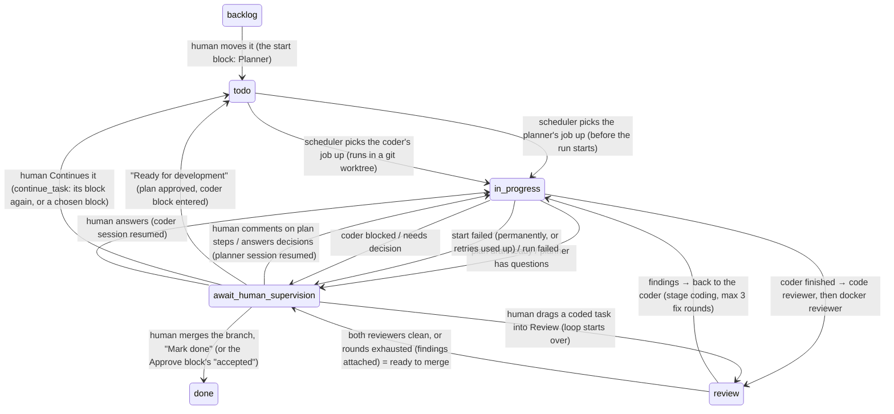

# Task workflow: plan → approve → code

How a board task moves through agents. Builds on the scheduler (docs/scheduler.md). Which
blocks a task runs, and in what order, is its **workflow** graph (docs/workflows.md); this
document describes the agents, prompts, results and the human loop those blocks use, and
the lifecycle of the seeded default workflow.

## Lifecycle (default workflow)



The **Review** column means "reviewers working": the task sits in `review` (stage
`code_review` or `qa`) while a reviewer runs, and goes back to `in_progress` (stage
`coding`) while the coder fixes their findings. **Ready to merge** is
`await_human_supervision` with stage nil, a worktree branch and no failed run
(`Engine.ready_to_merge?/1`; in the default workflow: the "Approve" block); the task page shows `#ready-to-merge` (branch name, open
findings) and the toolbar's `#mark-done` (→ `done`), and the notification is
`ready_to_merge` "Ready to merge: <title>". Under it, `#proof-of-work`
(`Board.ProofOfWork`) sums up what to weigh: the branch's files and lines (read once from
the coder's bridge per arrival at the gate), open findings per severity, each agent's last
report, runs per stage (time, cost, last state, log link), spend against the task's budget
and the span from the first run to the last.

**Merge helper.** While the task waits for a human with a branch outside planning and
coding, on a human block, a merger block or past its workflow's end
(`Engine.mergeable?/1`; never on another agent block, whose step isn't done), the
toolbar's `#merge-form` (`#merge-branch`, blank = the branch checked out in the
repository; `#merge-task` "Merge with agent", disabled until a merger agent can run)
calls `Board.merge_task(task, branch \\ nil)` (`Engine.merge/2`). The first runnable
**merger** (role `merger`, stage `merging`, profile `merger`) runs in the repository and
merges the worktree branch into the target with `--no-ff`, resolving conflicts (it
aborts and reports `blocked` when one needs a decision). The task keeps its place and
its assignee: the result, or a failed run, brings it back to the gate as it was, so the
human still decides. The job is on no block (`node_id` nil, so `restartable?/1` and the
audit timeline leave it out of the gate's runs) and records its target
(`jobs.merge_branch`); a reported merge into another branch (or none) counts as blocked.
A merge records `merged_into` / `merge_commit` (only a hex hash; `#merged-into` in the
banner) and notifies `merged`, a blocked one `merge_blocked`. On a stopped merger block a
blank merge runs that block again (its target, its instructions; refused on a version
with problems). A merger block does the same without a human
(docs/workflows.md).

Questions a human asks about a task (Ask tab) are answered beside this lifecycle and never
move the task; see "Ask" below.

### Review loop (automatic, after coder finishes)

1. **Code reviewer** (role `reviewer`): reads the worktree diff vs base branch, returns findings.
2. **Docker reviewer** (role `qa`): builds the worktree in its own throwaway container
   (repo's Dockerfile/compose if present, else a fitting generic image). Web app / browser
   extension → installs Chrome/Chromium in that container and drives it (Playwright).
   Other app types → best-fit approach (CLI runs, API calls, test suite, fuzzing inputs).
   Tears the container down afterwards. Goal: at least 5 real bugs. Every bug must be
   reproduced with steps + evidence (command output / screenshot path). If fewer than 5 are
   found within budget it reports the real count — never invents or inflates bugs.
3. Findings from either reviewer → coder session resumed with the list (`in_progress`) →
   coder fixes → back to step 1 (`review`). Max 3 rounds (the cap of the default's
   findings arrow; `review_round` on task), then ready to merge with the open findings
   attached.
4. Clean round → ready to merge (`await_human_supervision`, `ready_to_merge` notification).

**By hand.** Moving a task into `review` (board drag or drawer) starts the loop on its
worktree at the workflow's first reviewer block, with `review_round` and traversal counts
reset (`Changes.Transition` step `review`, `Engine.review/2`). Any other agent still working on the task (e.g. the coder) is
canceled first. A task whose reviewer is already queued or running keeps it: no second
review. A task without a worktree (never coded) is refused (`Validations.Reviewable`,
`Board.Errors.NothingToReview`: "Nothing to review yet: no code changes", shown as a flash).

- Moving a task to `todo` runs its workflow: its current block again, or the start block
  (docs/workflows.md). The block's role decides what the run does; which agent runs it is
  the block's own, else the first in the role that can run (the coder picked at approval
  for a coder role block), else, for a role with no agent at all while a connector is
  connected, the role's default agent, made then (`Organization.DefaultAgent`, see
  docs/workflows.md); the task needs no assignee, and gets the agent as one. A custom
  agent runs the task description as-is. A block whose agent can't run (no model or no
  connector) is refused at the move, naming the block (error `Agents.Errors.NotRunnable`:
  "Planner can't run: E2E Planner has no model yet. Configure it on the Employees
  page."); the board shows it as a flash and the card stays put.
- When the scheduler picks a job up it moves a task that isn't there yet to the job's
  working status (`Engine.working_status/1`: `review` for a reviewer, else
  `in_progress`; stage = the job's) with a `started` notification right away, before the
  bridge confirms the run. A question's job leaves the task alone.
- A start that can never work as asked (agent not set up, the bridge refuses the folder or
  model with a 422) fails the job at once: task → `await_human_supervision`, a system
  message and an `agent_failed` notification saying e.g. "The planner can't start:
  ~/Projects/app is not a folder on this computer". Bridge unreachable / 5xx is retried
  (docs/scheduler.md). Errors are stored and shown as their readable messages; Ash's
  breadcrumbs and stacktraces only go to the log (`Weworkai.ErrorText`; text saved
  before that is cleaned when rendered).
- **Continue** `continue_task(task, target \\ default)` (task page toolbar `#continue-task`,
  board drawer `#task-drawer-continue`; a split button "Continue → <default>" with a menu
  `#…-toggle` / `#…-<target>`) pushes any task on, also a stuck or failed one. Targets
  (`Board.continue_targets/1`, default first, each `%{id, label}`): the agent and human
  blocks of the task's workflow by node id (reviewer blocks once it has a worktree), and
  `"done"` (a move). Default: the agent block it is on (also after a failure: same as the
  old Restart), else its first reviewer block once it has code, else the start block.
  - It cancels the task's active jobs first (stopping their sessions), then enters the
    block: planner / coder continue their conversation with `Prompts.carry_on/0` (or
    start fresh without one); a reviewer block starts the review over with fix rounds and
    counts afresh; done = status only. Status → `todo` (reviewers: `review`), plus a
    `restart`-kind message "Continued by you → <block label>". The button asks first while
    an agent works on the task.
  - Refusals name what is missing (flash): an agent that can't run (`NotRunnable`, e.g.
    "Reviewer has no model yet. Configure it on the Employees page."), no agent in the role
    (`Board.Errors.NoAgent`: "No planner agent yet. Add one on the Employees page."), no
    worktree for a reviewer (`Board.Errors.NoWorktree`), a block gone from the workflow
    (`Workflows.Errors.Refused`). A review role with no agent at all is skipped with a
    `stage_skipped` notification, as in the automatic loop; one whose agents all lack
    setup is refused.
  - Filters on the copy's `updated_at`, so a second tab or a double click is refused.
- Every status change the workflow makes (and every agent failure) creates a Notification.
- A review block with no runnable agent in its role (`reviewer` / `qa`: model + connector
  set) is skipped with a `stage_skipped` notification, unless the role has no agent at all
  and a connector is connected: then its default agent runs (and when it can't be made,
  the task stops with a human instead of skipping), so with a connected connector
  reviews run unless the workflow leaves them out or the role keeps an agent without a
  model. The first runnable one (by id) is used.
- The review loop counts **fix rounds**: `review_round` goes up each time the coder is sent
  back with findings; the limit shown ("fix round n of 3") is the sum of the caps of the
  workflow's findings arrows into coder blocks (`Engine.fix_round_limit/1`).

## Ask

A human asks a question about a task on its page (Ask tab, `#ask-form`); an agent answers
it with the task's full context, without touching the task's own work.

- `Board.ask_question(task_id, body)` (`TaskMessage` action `:ask`, `Changes.Ask`) saves a
  `question` message and creates a Job with stage **`ask`** (`Engine.ask_job/3`). Refused
  (no message, no job) when the body is blank or no agent can answer.
- **Who answers:** the first runnable planner, else reviewer (`Engine.answerer/0`) —
  both read-only profiles, so a question can never change code. With neither, no planner
  at all and a connector connected, asking makes the default planner
  (`Organization.DefaultAgent`), which answers (`#default-answerer` on the Ask tab).
- **Which context:** the run forks the task's latest conversation, `code_session_id` (in
  the worktree) else `plan_session_id` (in the repository): the bridge's `resume` +
  `fork: true` → `claude --resume <id> --fork-session --session-id <new>`, so the original
  conversation gets nothing appended and may even be running meanwhile. A task without a
  conversation gets a fresh run whose prompt carries title, description, plan, the coder's
  summary and open findings (`Prompts.ask/2`). The run folder is the conversation's (claude
  keys conversations by cwd): worktree if present, else repository.
- **Not a stage:** no JSON schema; the run's final `result` (markdown) becomes a `reply`
  message and an `answer_ready` notification "Answer ready: <title>". The task's status,
  stage and `updated_at` don't change. `ask` jobs are left out of `Scheduling.active_jobs`
  and `latest_job`, so they never block `todo`/review moves, restarts or `restartable?`, and
  moving the task between columns leaves them running; deleting the task stops them
  (`active_asks`). A failed or unstartable answer is an `unanswered` message plus an
  `agent_failed` notification "Question failed: <title>"; the task stays put.
- UI: the Ask tab shows the thread (`#ask-thread`: question / reply / unanswered messages,
  also in Activity), `#ask-pending` with a spinner while `active_asks` is non-empty, and the
  form (`#ask-body`, `#ask-submit`; disabled with a hint when no agent can answer).

## Working indicator

`Task.activity` (calculation over the `working_jobs` relationship: jobs `before_start`,
`on_start` or `in_progress`; `Board.Task.Activity`) says what an agent does on the task now:
the job's stage and `:running` (picked up) or `:queued`. The workflow's job wins over a
question's, then a running one over a queued one. `list_tasks` / `get_task` load it in one
query for all tasks. The board card shows it as `#task-<id>-working` (spinner + "Planner
working", "Coder working", "Reviewer working", "Docker reviewer working", "Answering
question"; a pulsing dot + "… queued" while queued), the task page as `#task-working` next
to the status badges; the `#agent-working` banner shows while the workflow's own job is
active (`Activity.workflow?/1`). Every Job create/update is broadcast on "tasks" as
`{:task_updated, %{id: task_id}}`, so cards and pages follow jobs starting, finishing and
being canceled even when the task itself doesn't change. Spinners stand still under
`prefers-reduced-motion`.

## Code

- `Weworkai.Workflows.Engine` (`lib/weworkai/workflows/engine.ex`): what each run
  result does and what each human action does, on the task's graph (docs/workflows.md).
  The scheduler calls `run_started/2`, `run_done/1`, `run_failed/2` and `start_failed/2`
  instead of moving attempts itself. A result or action is built into a
  `Workflows.Transition` (task attributes + messages + notifications + jobs) outside any
  transaction, since building one may create the coder's worktree or ask the bridge for
  the diff, then applied in **one transaction together with the attempt's own transition**
  (`mark_completed` / `mark_run_failed` / …). Those only accept a `started` attempt, so a
  result is consumed exactly once: a crash before the commit leaves the attempt `started`
  and the next sync redoes it; after the commit the attempt is no longer `started`. After
  the commit the run is closed (`stopped_at`) so it leaves the dashboard.
- `Weworkai.Workflows.Prompts`: every prompt and JSON schema. Instructions come first,
  material (task, plan, diff, findings) last; prompts are cut to the bridge's 400 000-char
  limit, so a long diff or plan is truncated, never the instructions. A workflow block's
  own instructions (docs/workflows.md) join the role's. The bridge hands the
  prompt to `claude -p` on stdin, so no argv limit applies.
- `Weworkai.Workflows.Result`: casts a run's `structured` output into the stage's types
  (`Board.Plan`, `Board.Question`, `Board.Finding`). Missing or mismatching output = failed run.
- Task actions (`Weworkai.Board` code interface); the human ones build their transition
  with `Changes.Transition` (`step:` names the `Engine` function), which cancels the task's
  active jobs first unless the transition changes nothing:
  - `move_task(task, :todo)` → step `start` (its block again, or the start block). A task
    that still has an active job (queued, starting, running or held) keeps it: no second
    job, worktree or stage reset. `:review` → step `review` (see "By hand").
    `:done` / `:canceled` end the workflow (`current_node_id` → nil).
  - `move_task(task, status)` to anything but `todo` / `in_progress` → `Changes.CancelJobs`
    cancels the task's active jobs, which stops a running agent session, so its result is
    never applied.
  - `destroy_task(task)` cancels the task's active jobs first (stopping a running agent
    session), since the jobs themselves are deleted with the task.
  - `Organization.destroy_employee(employee)` of an agent: each of its active jobs is canceled
    (stopping its run) and its task handed to a human (`Engine.agent_removed`: system
    message + `agent_failed` notification), since the agent's jobs are deleted with it.
  - `comment_on_plan(task, body, step_ids \\ [])`: stage `planning`, status
    `await_human_supervision`, plan present → comment message, planner resumed, `in_progress`.
  - `answer_questions(task, %{"q1" => "answer"})`: stage `planning` or `coding`, status
    `await_human_supervision`, one non-blank answer per open question id and no other ids
    (`Validations.AnswersOpenQuestions`) → answer message, planner or coder resumed, `in_progress`.
    The update also filters on the questions themselves, so answers to questions a newer agent
    result replaced (agents reuse ids like `q1`) are refused.
  - `approve_plan(task, coder_employee_id \\ nil)`: stage `planning`, status
    `await_human_supervision`, plan present, the employee (when given) a coder agent that can
    run (model + connector set), then pinned for the task's coder role blocks → takes the
    approval arrow (docs/workflows.md): sets `plan_approved_at`, `todo`, the coder block's
    agent as assignee, its worktree and job.
  - `decide_task(task, edge_id)`: status `await_human_supervision`, the arrow leaves the
    human block the task is on → takes it, with a `decision` message.
  - `update_task(task, %{workflow_id: id})` switches the workflow and starts it over.
  - `advance_task(task, attrs)`: the engine's own writes; not for the UI.
  - The human actions also filter on the state they validate (or on `updated_at`), so the
    database refuses one acting on a copy of the task that is no longer current (a second
    tab, a double submit): the agent is resumed once.
- `Weworkai.Notifications`: `recent_notifications(limit \\ 20)` (newest first),
  `list_notifications(unread_only?, limit \\ 20)`, `get_notification(id)`, `unread_notification_count()`,
  `mark_notification_read(notification)`, `mark_all_notifications_read()`, `notify(attrs)`.
- UI: `WeworkaiWeb.NotificationsHook` is the `on_mount` of the router's `live_session`, so every
  page has the bell (`@notifications`, `@unread_count`, passed to `<Layouts.app>`). It subscribes
  to `"notifications"`, handles `open_notification` (marks read, opens `/tasks/:id`) and
  `mark_all_notifications_read`, and pushes each new notification as a `"notification"` event.
  The layout's `.NotificationToasts` hook shows it as a toast, or as a desktop notification
  while the tab is hidden (permission is asked only from the bell panel's button). Views
  that react to notifications implement the hook's `handle_notification/2` (TaskLive reloads,
  the `/notifications` page re-streams); notification messages never reach `handle_info`.
  Reading one (or all) broadcasts `:notifications_read` on `"notifications"`, so every other open
  tab reloads its bell (and the `/notifications` page its list).

## Data model

**`tasks`** (workflow fields)

| field | |
|---|---|
| `repository` | folder of the git repo the agents work in; blank means `~/Projects` (the bridge's default allowed root), prefilled in the new task form; editable in the form, the drawer and the task header, each with a folder picker listing the bridge's allowed folders (`GET /folders`) |
| `stage` | `planning` \| `coding` \| `code_review` \| `qa` \| `merging` \| nil (not in an agent stage, e.g. ready to merge) |
| `merged_into` / `merge_commit` | the merger's last merge of the branch; cleared when the coder finishes new work |
| `plan` | embedded `Board.Plan` (`summary`, `steps[id,title,description,changes[path,diff]]`, `questions`) — latest plan |
| `plan_approved_at` | set by `approve_plan` |
| `plan_session_id` / `code_session_id` | Claude conversation of the planner / coder, resumed by later runs |
| `worktree_path` / `worktree_branch` | the coder's worktree, set when the coder is enqueued |
| `worktree_repositories` | for a task on a folder of repositories, the repositories its (headless) worktree holds; `[]` for a single repository |
| `review_round` | fix rounds so far (0–3); reset when a coder is enqueued |
| `open_questions` | embedded `Board.Question` list waiting for a human (planner's or coder's); cleared by comment / answer / approve |
| `findings` | embedded `Board.Finding` list of the current review round, each with `source` (`reviewer` \| `qa`) |
| `outcome_summary` | the coder's (or a custom agent's) last summary |
| `workflow_id` / `current_node_id` / `edge_counts` / `node_counts` | the task's workflow, the block it is on, traversals per arrow, runs in a row per block (docs/workflows.md) |

Every task update is broadcast on PubSub topic `"tasks"` as `{:task_updated, task}`; the
board re-streams the card. A deleted task is broadcast as `{:task_deleted, task}`: boards drop
the card (and close its drawer), its task page goes back to the board with a flash.

**`task_messages`** (`Board.TaskMessage`): `task_id`, `author` (`human` \| `agent`),
`agent_role` (agent messages), `kind` (`comment` \| `answer` \| `plan` \| `outcome` \| `findings` \| `system` \| `restart` \| `question` \| `reply` \| `unanswered` \| `decision`),
`body` (markdown), `step_ids`, `inserted_at`. `list_messages(task_id)` returns them oldest first.
Failures are `system` messages.

**`notifications`** (`Notifications.Notification`): `task_id` (nullable; deleted with the task),
`kind` (`started` \| `plan_ready` \| `needs_answers` \| `ready_for_review` (no longer sent) \| `ready_to_merge` \| `answer_ready` \| `stage_skipped` \| `agent_failed` \| `decision_needed` (a human block) \| `workflow_stuck`),
`title`, `body`, `read_at`, `inserted_at`. Each new one is broadcast on `"notifications"` as
`{:notification_created, notification}`. Start failures notify once: at once when permanent,
when the last retry failed otherwise.

**`jobs`** gained `agent_id` (the run's agent — the task's assignee, or the reviewer / qa
agent), `stage` (a task stage, or `ask` for a question), `prompt`, `json_schema`, `resume`
and `fork`; see docs/scheduler.md.

## Agent runs are headless

Agents run as `claude -p --output-format stream-json --verbose` processes started by
`bin/claude_bridge` (not `--bg` sessions), because the workflow needs a final structured
result (`--json-schema`) and must resume the same conversation (`--resume <uuid>`).

- The bridge passes `--session-id <uuid>` on a new run, so the app knows the Claude
  conversation id up front and stores it on the task (`plan_session_id`, `code_session_id`).
- Resuming = a new run with `resume: <uuid>`; same conversation, new prompt. With
  `fork: true` (needs `resume`) the run continues a copy instead: `--resume <uuid>
  --fork-session --session-id <new uuid>`, so the original conversation is left as it was
  and may be running at the same time (the one-run-per-conversation check sees the new id).
- Bridge run status: `running` → `done` | `failed` | `stopped`. `GET /sessions/:id` returns
  a readable log (rendered from stream-json) and, when done, `result` (the final text) and
  `structured` (the `--json-schema` output).
- Each run's stream-json log and metadata live in `~/.weworkai-bridge/runs/` (override
  with `CLAUDE_BRIDGE_STATE`), so runs survive a bridge restart. Finished runs are deleted
  after `CLAUDE_BRIDGE_KEEP_DAYS` (default 7; checked at startup and hourly), and a run's
  prompt file as soon as claude has it open. One conversation runs at most once at a time:
  resuming a conversation that is still running is refused (the check and the start are
  serialized, so two concurrent resumes can't both pass).
- The app sends a `profile` (the agent's role); the bridge maps it to what the agent's
  container can reach (see "Agents run in containers"). The app never sends tool lists.
- Coder works in a git worktree the bridge creates: `<repo>/.weworkai/worktrees/<task-short-id>`
  on branch `weworkai/<task-short-id>`.
- **Headless worktrees.** A task's folder may be no git repository but a folder of them
  (`~/Projects`). The coder then gets `<folder>/.weworkai/worktrees/<task-short-id>/`, a
  folder holding one worktree per repository directly in it (`<id>/<repo>`), all on
  `weworkai/<task-short-id>`; the task keeps their names (`worktree_repositories`) and every
  prompt says so. The diff prefixes paths with the repository (`api/lib/x.ex`); the merger
  merges each repository with commits. At most `CLAUDE_BRIDGE_MAX_REPOS` (default 20)
  repositories; a folder with more is refused (pick a smaller one).
- Files a human attaches to a task (at most 25 MB each, 100 MB per task) reach every run on
  it: the app sends them with the run (`attachments`, base64) and the bridge writes them to
  `<cwd>/.weworkai/attachments/<task-short-id>/` first, replacing the last run's copy.
  `.weworkai/` is git-excluded, so a coder never commits them. Each stage's first prompt
  lists them; a resumed run finds the current files but is not told about changes. Humans
  open them at `/attachments/:id`: raster images inline, everything else as a download.

## Agents run in containers

Every agent runs with all permissions (`--dangerously-skip-permissions`), so the boundary
is the container, not a tool allowlist: `docker run --rm --name cph-<run id>` of the
`weworkai-agent:<hash>` image (`docker/agent/Dockerfile`: Node, the pinned Claude Code
CLI, git, ripgrep, build-essential, python3, the docker CLI; non-root user `agent`).
Whatever an agent breaks stays in its container; only the mounts below reach the host.

- **Image.** The bridge tags it by the content of `docker/agent/` and builds it before it
  starts listening when that tag is missing (or run `bin/claude_bridge --build-image`). A
  start while the image is missing builds it in the background and answers 503, so the
  scheduler retries. To add a toolchain (Elixir, Ruby, Go…) or bump `CLAUDE_CODE_VERSION`,
  edit the Dockerfile; the next bridge start rebuilds. On Linux the image is built with the
  host user's uid/gid so files the agent writes stay yours; Docker Desktop maps ownership
  itself.
- **Mounts** (same absolute path inside as on the host, and that path is the cwd):

  | profile | run folder | git directory (`<repo>/.git`) | docker |
  |---|---|---|---|
  | planner, reviewer | read-only | read-only | none |
  | coder, custom | read-write | read-write, except `config` and `hooks` (read-only) | none |
  | qa | read-write (it may build) | read-only | own `docker:dind` sidecar |
  | merger (run folder = the repository, worktrees inside it) | read-write | read-write, except `config` and `hooks` (read-only) | none |

  A worktree's `.git` file points into `<repo>/.git/worktrees/<name>`, so the coder's
  `git commit` in the container lands on the host's `weworkai/<task>` branch. `config`
  and `hooks` stay read-only because the host's git (the user's and the bridge's
  `worktree_diff`) would run what they name. A writable git directory still lets a coder
  move other branches' refs; it can't run code on the host. Commits carry the host's
  `git config user.name` / `user.email` of that repo (`GIT_AUTHOR_*` / `GIT_COMMITTER_*`).

  A run in a folder of repositories, or in a headless worktree, gets the same for each
  repository's git directory.
- **Docker reviewer.** The host's Docker socket is never mounted. Each qa run gets a
  privileged `docker:dind` sidecar `cph-<run id>-dind` whose daemon listens on
  `127.0.0.1:2375` of a network namespace the agent shares (`--network container:…`,
  `DOCKER_HOST`), so no other container can reach it. The agent's entrypoint waits for it.
  Images, containers and ports the agent starts live in the sidecar, which is removed (with
  its volumes) when the run ends or is stopped.
- **Login.** Run `claude setup-token` once and save the token to
  `~/.weworkai-bridge/oauth-token` (`chmod 600`). The bridge reads it at each start and
  hands it to `docker run` as `CLAUDE_CODE_OAUTH_TOKEN` in docker's own environment
  (`--env CLAUDE_CODE_OAUTH_TOKEN`, a name only), so it is never in argv, a run log, the
  metadata or an HTTP reply (it does show in `docker inspect` of a running agent). Missing
  token → 422 "Agents have no Claude login: run `claude setup-token` …", which fails the
  job at once. Docker not running → 503, retried.
- **Host tools.** CLIs in the image that act with your login on this computer
  (`HOST_TOOLS` in the bridge; today `glab`). At each start the bridge reads the login
  (`glab config get host`, `glab config get token --host …`) and passes it like the Claude
  token, by name only: `GITLAB_HOST`, `GITLAB_TOKEN`. Every role gets it (a profile's
  `host_tools` could turn it off); such a token can write to GitLab, push included, which no
  mount prevents. Add a tool to `HOST_TOOLS` and the Dockerfile. The bridge prints at
  startup which host tools are installed and logged in.
- **Your `~/.claude`.** Each run gets a copy (symlinks followed; `.git`, `node_modules`
  skipped; at most 50 MB per entry) of `CLAUDE.md`, `skills`, `agents` and `commands`
  (override with `CLAUDE_BRIDGE_SHARE`, colon-separated; `CLAUDE_BRIDGE_CLAUDE_HOME` for
  another folder), mounted read-only into the agent's `~/.claude` and deleted when the run
  ends. Credentials, history, conversations, `settings.json` and plugins never reach agents.
  `CLAUDE.md`, `CLAUDE.local.md` and `.claude/` of the run folder's parents (inside an
  allowed root, below your home) are mounted read-only, so a worktree sees the main
  repository's untracked ones.
- **Tool usage.** `GET /sessions/:id` returns `tools`: what the run could use (claude's
  tools and skills, the host tools and `~/.claude` parts it got) and what it used (calls per
  tool, skills, each host-tool command); the run page shows it. Each finished run's
  host-tool calls are appended to `~/.weworkai-bridge/tool-usage.jsonl` (pruned with the
  runs) and printed by the bridge. `GET /tools` lists the host tools and their login, the
  shared `~/.claude` and the latest 50 calls; the Connectors page shows it.
- **Conversations** persist in the named volume `weworkai-agent-claude` (the agent's
  `CLAUDE_CONFIG_DIR`), keyed by cwd like on the host, so `--resume` works across runs.
  Host `claude --resume` doesn't see them; to continue one yourself:

  ```sh
  CLAUDE_CODE_OAUTH_TOKEN="$(cat ~/.weworkai-bridge/oauth-token)" docker run --rm -it \
    -e CLAUDE_CODE_OAUTH_TOKEN -v weworkai-agent-claude:/home/agent/.claude \
    -v "$FOLDER:$FOLDER" -w "$FOLDER" weworkai-agent:latest claude --resume <conversation>
  ```
- **Limits.** `CLAUDE_AGENT_MEMORY` (default `4g`) and `CLAUDE_AGENT_CPUS` (default `2`)
  apply to every agent container and sidecar. Agents use Docker's default `bridge` network
  (they need the API). `--security-opt no-new-privileges`, `--init`.
- **Status and stop.** The `docker run` client is the run's process: its exit ends the run,
  its stdout is the stream-json log. A run started by an earlier bridge process is checked
  with `docker inspect` instead. Stop = `docker rm --force` of the agent container and its
  sidecar. Containers are labeled `weworkai.run=<run id>`.

## Structured outputs

Planner (`plan` schema):

```json
{
  "summary": "markdown",
  "steps": [
    {"id": "s1", "title": "…", "description": "markdown — the why",
     "changes": [{"path": "lib/x.ex", "diff": "unified diff of the intended change"}]}
  ],
  "questions": [{"id": "q1", "question": "…", "options": ["a", "b"]}]
}
```

Non-empty `questions` = the plan needs decisions; still lands in `await_human_supervision`.

Reviewers (`findings` schema):

```json
{"summary": "markdown", "findings": [{"id": "f1", "severity": "high|medium|low",
  "title": "…", "path": "lib/x.ex", "line": 12, "details": "markdown",
  "reproduction": "steps", "evidence": "output / screenshot path"}]}
```

Coder (`outcome` schema):

```json
{"status": "done" | "blocked", "summary": "markdown",
 "questions": [{"id": "q1", "question": "…", "options": []}]}
```

Merger (`merge` schema):

```json
{"status": "merged" | "blocked", "summary": "markdown", "branch": "main",
 "commit": "merge commit hash, empty when blocked"}
```

## Human loop (task view `/tasks/:id`)

- Plan tab: summary, steps with descriptions and GitLab-MR-style diffs. Select one or more
  steps (or diff lines), write a comment → planner resumes with
  "Revise the plan. Comments: [step s2] …". Questions render as decisions to answer.
- Toolbar "Ready for development": saves the plan as approved and moves to `todo` (the
  approval arrow); a coder select shows only for a coder role block with several coders
  that can run, and pins the one picked.
- Toolbar decision buttons (`#decide-<edge id>`): one per arrow out of the human block the
  task waits on, e.g. the default's "Approve": `accepted` (→ Done), `continue` (→ Coder).
- Coder questions render the same way; answers resume the coder session.
- Conversation history: `task_messages` (author: human | agent, body, step refs).
- `WeworkaiWeb.TaskLive` (tabs Plan | Decisions | Findings | Ask | Activity | Runs, `?tab=`).
  Without `?tab=` the tab follows the task (Plan once a plan lands); a chosen tab stays.
  Below `xl` the "Request changes" panel is a one-line sticky bar that opens on tap.
  Diffs are parsed by `Weworkai.Diff` (pure; numbered old/new lines per hunk). Clicked
  diff lines are appended to the comment as `- \`path:line\``. The view reloads on
  `"tasks"` and `"notifications"` broadcasts for its task. A workflow change is announced by its
  notification's toast only; the view adds no flash of its own, and a reload that finds the
  status changed clears the info flash of the human's last action (it would cover the toolbar).
- Banners: `#agent-working` (planner / coder at work, "The code reviewer is reading the
  change." in review, "fixing the reviewers' findings (fix round n of 3)"), and
  `#ready-to-merge` with `#mark-done` in the toolbar.
- Board: a card with a plan or waiting for a human (marked "Needs you") opens `/tasks/:id`;
  other cards open the details drawer at `/tasks/:id/edit`, which links to the task view.

## Testing

- Unit/LiveView: `docker compose exec web mix test`; bridge stubbed with `Req.Test`.
- Bridge: `python3 bin/claude_bridge --self-test` (`docker run` argv per profile: mounts,
  read-only flags, sidecar, env names without values; token file and Docker checks; input
  validation, `fork` argv and a fork starting beside its running conversation, attachments
  written before the container starts inside its read-only mount, stream-json rendering,
  concurrent resumes, stop and restart detection by
  container, pruning and the finished-run cache; headless worktrees (creation, diff,
  mounts); the shared `~/.claude` copy and parent-folder memory; tool-usage parsing and
  log; the GitLab token by name only; a fake docker CLI and `sh` in place of
  docker run, so no Docker needed).
- Browser e2e: `docker compose --profile e2e run --rm e2e` — Playwright (Chromium) container
  (`e2e/`) driving a separate app instance, `web-e2e` (`http://web-e2e:4000`, database
  `weworkai_e2e`, own `_build` volume), which talks to `fake-bridge`
  (`bin/fake_claude_bridge`) instead of the real bridge. The dev database is never touched.
  Every spec asserts the LiveView socket connected (`[data-phx-main].phx-connected`).
  Screenshots and traces of failures land in `e2e/test-results/`
  (`npx playwright show-trace <trace.zip>`).
- The fake bridge finishes every run after ~1s with a canned result per profile: planner →
  2-step plan + 1 question (resumed → revised plan, no questions); coder → done; reviewer /
  qa → no findings; a planner / reviewer run without a JSON schema (a question, forked or
  not) → "Fake answer to: <first line after `# Question`>". `fork` without `resume` is
  refused like the real bridge. Markers in the prompt script other outcomes: `[fake:blocked]` (coder
  blocked with a question), `[fake:findings]` (reviewer / qa return 2 findings),
  `[fake:fail]` (run fails).
- The app reaches the bridge at `CLAUDE_BRIDGE_URL` (default `http://host.docker.internal:4141`).
